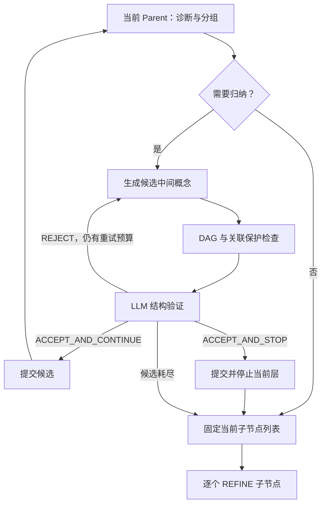

# Task 2 — LLM-Guided Recursive Intermediate Concept Induction

本模块已经实现。运行范围独立于 Event Extraction 和已有 Baseline；Task 1 的数据准备入口仍然可用。本次交付中的可视化、计数与模型决策均来自 **Synthetic Data + Mock LLM**，用于检查控制流程，不构成真实生物医学实验效果。

## 1. 可运行入口

在仓库根目录运行，Python 3.9+；核心实现仅使用标准库。当前持久化锁使用 `fcntl`，支持 macOS/Linux。

```bash
python3 -m event_taxonomy induce --run-id task2-my-demo
python3 -m unittest discover -s event_taxonomy/tests -v
```

默认配置 `configs/task2.mock.json`，输出到新的 `event_taxonomy/runs/<run-id>/`。已有运行目录会报错，不能覆盖。

暂停与恢复示例：

```bash
python3 -m event_taxonomy induce --run-id task2-resume-demo --step-limit 7
python3 -m event_taxonomy resume --run event_taxonomy/runs/task2-resume-demo
```

`--step-limit` 是持久化状态转换次数，不是 LLM 调用次数或优化轮数。运行中的 `execution_status.json` 区分 `paused`、`interrupted` 和 `completed`。`completed` 仅表示控制流程已经结束，**不代表全局最优或经过人工验证**。图本身仍标记为 `partial`。

## 2. 代码与完整 Prompt

| 文件 | 职责 |
|---|---|
| `induction/recursive.py` | 核心 REFINE 状态机、同层循环、子节点递归、DAG 上下文重访 |
| `induction/graph.py` | 纯候选构造、原关系保护、结构签名、事务式接受 |
| `induction/context.py` | 父节点、直接子节点、完整祖先边、多父关系、事件和证据样本 |
| `induction/contracts.py` | 三个模块输出的严格 JSON 及引用校验 |
| `induction/clustering.py` | LLM-guided / Embedding complete-link 两种可替换策略 |
| `induction/providers.py` | Mock 回放、OpenAI-compatible HTTP 接口 |
| `induction/journal.py` | 模型请求、完整返回、缓存、调用预算 |
| `induction/storage.py` | 原子文件写入、checkpoint、排他运行锁 |
| `induction/dataset.py` | Task 1 数据对接与前置完整性检查 |
| `induction/run.py` | 独立实验入口、输入及代码冻结、恢复、保留率报告 |
| `induction/visualize.py` | 初始/最终 SVG 与逐轮离线 HTML 查看器 |
| `tests/test_induction.py` | 递归顺序、拒绝、停止、DAG、证据保护、恢复和传输测试 |

三个完整 Prompt 均独立保存并带版本号：

- Module A：[`prompts/diagnosis.v1.txt`](prompts/diagnosis.v1.txt)。输出 `need_induction / candidate_subgroups / structural_issues / reasoning / confidence`。
- Module B：[`prompts/induction.v1.txt`](prompts/induction.v1.txt)。输出新概念的 label、description、精确子概念集合；允许不采纳某个分组。
- Module C：[`prompts/validation.v1.txt`](prompts/validation.v1.txt)。输出三态决策，并逐条验证所有新增边、改善性、重复性与剩余分组机会。

版本策略：改变实验语义时新增 `v2` 文件并修改实验配置；运行目录冻结本次使用的完整文本及哈希，不能用后续 Prompt 替换历史实验的判定依据。

## 3. 核心控制顺序



Python 通过显式 DFS 栈保存递归帧，避免 Python 调用栈无法恢复。帧包含 `parent_id / depth / phase / round / attempt / feedback / diagnosed_signatures`。一次接受后：

1. `ACCEPT_AND_CONTINUE` → 同一个帧回到 `diagnose`，重新读取 Parent 的新 Children，尚未进入子节点。
2. `ACCEPT_AND_STOP` → 同一层结束，然后逐个压入子节点帧。
3. `REJECT` → 丢弃候选图，保留原图，附上拒绝意见并生成替代候选。替代方案可以更改 label/definition、选择其他已提出的分组或跳过部分分组；本轮固定分组集合，不隐式改变成员。达到 `candidate_attempts` 后停止当前层，仍处理子节点。

候选校验失败同样走拒绝分支。完全相同的失败候选不会再次送入 C。A 的 JSON 无效、置信度不足或上下文过大时停止当前层并继续遍历；传输中断则保存可恢复状态，不将调用失败解释为“无需归纳”。

## 4. DAG、关联与不变量

- 原 Root、原 Concept 的 **全部字段** 保持一致；原 Event、Evidence、Document 冻结在 `frozen/input_dataset.json`。
- `instance_concept_links` 和所有原 `concept_evidence_mapping` 行逐项保留。不会把 Event 从原细粒度概念改接到新增中间层。
- 中间概念的 `supporting_event_ids / evidence` 是对应子概念集合的去重并集；新增 mapping 标记 `derived_from_descendants`，不伪装成直接抽取证据。
- 只把选定的 `Parent → Child` 边改为 `Parent → Intermediate → Child`。其他父节点的边和未分组节点原边保持不变。
- 支持子群重叠：一个子节点可连接多个新中间节点。仍需每条关系通过严格上下位验证。
- 候选先在副本中生成；检查无环、无悬空节点、无自环、无重复边、引用有效、所有原祖先可达关系保留。接受后，原 accepted 可达关系也不能被降级。
- 新增 label 与已有 label/alias 的规范化形式、已有 definition 的规范化形式不能相同；同一个候选不能为同一子群生成多个中间概念。语义同义但字面不同的冗余由 C 结合完整概念目录判断，仍需后续人工评测，程序不能证明生物医学语义正确。
- `provisional_parent_ids` 是不可变的输入来源字段；当前层级以 `parent_child_edges` 为准，不能把历史 provisional 字段当作实时父节点列表。

共享节点按 **局部上下文签名 + 已处理深度** 记录：签名包含当前直接子节点、祖先闭包、相关边状态及其他父节点。相同上下文、相同或更少可用深度的访问跳过；另一个分支改变共享节点的祖先结构后允许重访。首次经深路径到达、后来经短路径到达时，重新利用剩余递归深度。所有根处理后再扫描尚未检查的新上下文；`context_visits_per_node` 限制重访次数。

## 5. 分组与归纳

默认 `llm_guided` 使用 A 提议的语义子群；不是按子节点数量触发。A 必须综合定义、证据、抽象跨度与潜在结构改善，可以明确返回不归纳。

替换为 `embedding` 时：

```json
{
  "method": "embedding",
  "vectors_file": "../data/concept_embeddings.json",
  "cosine_threshold": 0.82,
  "max_cluster_size": 20
}
```

`vectors_file` 格式为 `{ "concept_id": [0.1, 0.2, ...] }`。向量须预先提供；本模块没有下载或调用 Embedding 模型。实现对当前父节点的直接 Children 做确定性的 complete-link cosine 聚类，保证簇内最小相似度达到阈值。单节点和缺失向量节点保留为 outlier；新增中间概念没有向量时，使用其**唯一的、已有向量的后代**均值并归一化，写入聚类日志。该均值是可追溯的近似表示，并非新调用模型产生的语义向量。

两种策略都先经过 A 的“需要归纳”判断，输出统一的 `group_id / child_ids / reasoning`，由 B 生成定义，再由 C 检查。相似度本身不证明上下位关系。添加第三种策略只需实现 `cluster(context, diagnosis, taxonomy) -> (groups, metadata)` 并在 factory 注册。

设计参考：[TaxoAdapt, ACL 2025, §3.3.2](https://aclanthology.org/2025.acl-long.1442/) 将父主题、层级路径等上下文用于扩展。本模块只借鉴上下文感知分组的思想，**没有宣称复现其算法**；这里处理的是已有 Event Concepts，并按用户指定顺序先稳定兄弟层级。

## 6. 停止与配置

| 设置/条件 | 默认值 | 行为 |
|---|---:|---|
| A 判定不需要归纳 | — | 停止当前层，进入子节点 |
| C 判断未改善 / 冗余 / 不严格上下位 | — | 拒绝当前候选，可有限重试 |
| `iterations_per_parent` | 6 | 每次 REFINE 调用的同层循环上限；到限后继续子节点 |
| `candidate_attempts` | 3 | 每轮包含首次生成在内的候选次数 |
| `max_depth` | 12 | 根深度为 0，超过上限的分支不再深入，其他分支继续 |
| `context_visits_per_node` | 4 | 每个节点最多执行的上下文检查次数；到限后仍遍历子节点 |
| `new_nodes` | 100 | 本次运行最多新增的中间概念数 |
| `llm_calls` | 300 | 全局请求尝试数，失败/未确认请求也计入；缓存不计新调用 |
| 三阶段 confidence threshold | 0.65 / 0.65 / 0.75 | 低置信度结果不能触发接受 |
| `evidence_per_concept` | 3 | 按 ID 稳定排序采样，完整 ID 列表仍保留，并披露省略数量 |
| `max_ancestor_paths` | 32 | 限制路径枚举，祖先边集合完整保留 |
| `max_characters` | 200000 | 整个请求的序列化字符上限；超限不截断 Children，停止当前层 |
| 重复局部状态 / 失败候选 / 已接受全局状态 | — | 拒绝或停止，避免循环；继续未处理分支 |

模型、temperature、max_tokens 可按 A/B/C 分别设置。默认温度与阈值是可运行起点，未经过真实数据调参或性能验证。字符数限制不是 tokenizer 精确限制；实际模型 token 上限仍应按所选服务调整。模型自报置信度不是校准概率。

## 7. 接入真实输入

`dataset` 可以指向：

1. Task 1 导出目录：`initial_taxonomy.json / events.jsonl / evidence.jsonl / documents.jsonl`；或
2. 一个 JSON：`{ data_origin, taxonomy, events, evidence, documents }`，结构见合成 fixture。

前置检查要求标签及定义非空、所有输入概念有 Root 路径、Event/Evidence/Document 外键与证据位置有效、原事件关联可解析。默认 `require_semantic_input_frozen=true` 要求 `input_freeze_status=semantic_input_frozen`；这应在定义、类型及初始归属审查后设置，不能把设置标志本身当作审查。若专门进行未审查输入的消融，可明确设为 false；缺失定义、断开层级和无效证据仍会阻止运行。

**当前 Task 1 workbench 的 76 个类型概念尚未完成定义与初始归属审核，初始图没有父子边，不能直接用于这次归纳实验。** 系统会列出原因，不会偷偷补定义、强行分配 Root 或把 topic 当 event type。

真实调用使用 `configs/task2.live.example.json` 的副本：填写数据路径、服务 `base_url`、三个模型 ID，把密钥放在 `EVENT_TAXONOMY_API_KEY` 环境变量中，然后：

```bash
python3 -m event_taxonomy induce --config event_taxonomy/configs/task2.live.json --run-id task2-real-001 --live
python3 -m event_taxonomy resume --run event_taxonomy/runs/task2-real-001 --live
```

服务需支持 OpenAI-compatible `/chat/completions`、JSON object response format、`max_tokens`；额外服务参数放 `provider.extra_body`，不能覆盖 messages/model 等核心字段。接口已使用模拟 HTTP 传输测试，本次没有调用真实 API，也未验证某个线上模型的生物医学判断能力。A 和 C 是独立的模块与 Prompt；可配置不同模型，但不据此声称统计独立或无共同偏差。

## 8. 冻结、恢复与日志

每次实验包含：

- `manifest.json`：输入、配置、Prompt、Mock、Embedding、代码快照的哈希及实验指纹。
- `frozen/`：完整输入及参数副本；恢复不依赖外部原始文件仍存在。
- `code_snapshot/event_taxonomy/`：本次 Python 实现。恢复时校验当前代码；代码改变后应从此快照恢复，不能混用版本。
- `llm/*.json`：每次请求的系统 Prompt、全部输入、模型参数、原始文本、返回信封、finish reason、usage 和状态。不保存密钥；传输错误只记录安全的错误类别/状态码。
- `steps/<序号>/before.json / after.json / change.json`：每次状态转换；有候选时另存 `candidate.json`，包括被拒绝候选。
- `checkpoint.json`：图、递归栈、轮次、候选、反馈、已处理签名和预算进度。
- `change_log.json`：已提交步骤的汇总；实际修改轮次可筛选 `action=accept_candidate`。
- `initial_taxonomy.json / final_taxonomy.json / preservation_report.json`。
- `initial.svg / final.svg / visualization.html`：初始、最终及逐步比较。

写入顺序是日志/快照在先、checkpoint 最后提交，均通过临时文件 + fsync + 原子替换完成。崩溃时可能留下未提交步骤；恢复按 checkpoint 重新执行并覆盖同一序号，已持久化的成功模型回复按请求指纹复用。模型已收到请求但回复尚未持久化时，不能保证远端 exactly-once；恢复可能再次请求，日志明确保留这种不确定性。运行锁防止两个进程同时修改同一实验。

从代码快照恢复示例（在仓库之外的工作目录执行，使当前源码不会遮蔽快照）：

```bash
cd /tmp
PYTHONPATH=/absolute/run/path/code_snapshot python3 -m event_taxonomy resume --run /absolute/run/path
```

离线可视化不依赖服务器或外部脚本。生成 SVG 时优先使用机器上已有的 Graphviz `dot` 进行布局，以减少 DAG 连线穿过节点；未安装时使用标准库 SVG 布局，不影响归纳。按钮可看初始、最终、每个关键步骤及未提交候选；节点悬停显示 ID 和定义。颜色区分 Root、保留概念和新增中间概念，虚线为 provisional 边。

## 9. 本次验证范围

合成示例包括 3 个 Root、8 个细粒度 Concept、8 个 Event、8 条证据；2 个概念初始同时归属 CARE 与 RESEARCH。预设 Mock 演示一次拒绝、替代候选接受后继续同层、第二轮接受后停止、以及多父边保留。

预期演示结果：11 → 16 节点，10 → 15 边；3 个候选接受、1 个拒绝；17 次 Mock 调用。原 8 个 Concept、Event、Evidence 及关联全部保留。新增 5 个中间概念是**合成测试行为，不是数量目标或优化效果指标**。

单元测试覆盖当前层优先、各停止条件、候选拒绝/重试、重叠子群、多父节点重复访问、祖先变化重访、深浅路径深度预算、环及非法引用、原概念/关联保护、无效 JSON、Embedding outlier、暂停恢复一致性、提交前崩溃缓存复用、输入/Prompt/checkpoint 校验与并发锁。真实语义质量、跨模型稳定性和人工基准评测留给后续实验阶段。
